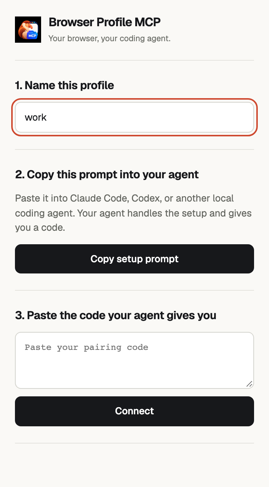
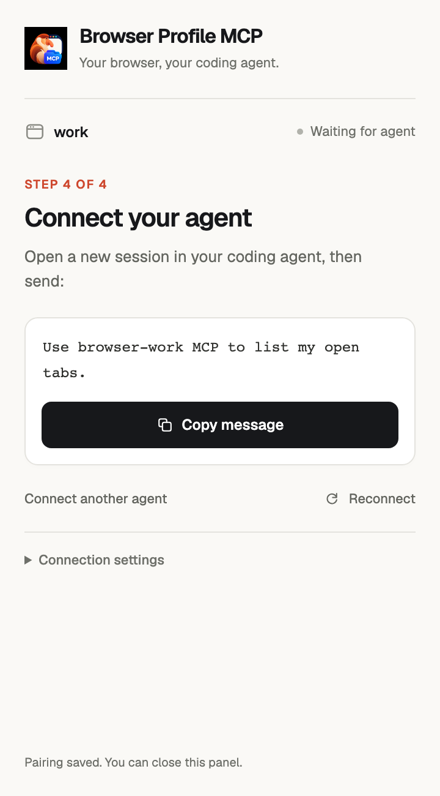
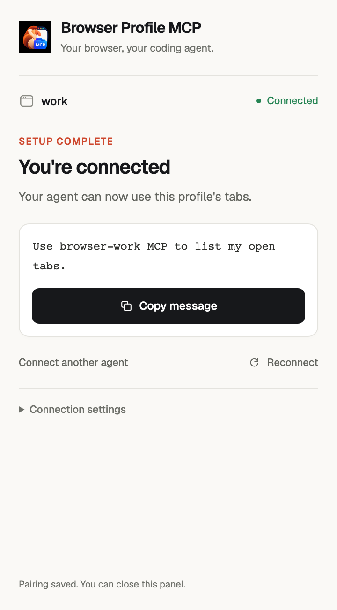

# Browser Profile MCP

Let Codex or Claude Code control the tabs in your **already-open Chrome profiles**, using their existing website logins. Your AI login stays in the coding agent.

Set up each profile once. After that, open your coding agent and use the browser tools: **the agent starts the local bridge automatically**. There is no daily `npm start` step and no terminal to leave running.

Requires a local Codex or Claude Code client and Chrome 118+ on the **same computer**. You do not need an OpenAI or Claude login inside the Chrome profile.

## Download

Get the [latest release](https://github.com/guilhermegm/browser-profile-mcp/releases/latest):

- **Extension ZIP:** unzip it into a permanent folder, open `chrome://extensions` in the intended profile, enable Developer mode, and choose **Load unpacked** with that folder. Pin the extension and open its side panel.
- **Bridge ZIP:** the local Node.js helper used by your coding agent. The extension's setup prompt tells your agent where to download it, verify its checksum, and install it. You do not need to start a separate app or leave a terminal running.

The bridge needs Node.js 20+ and npm. Its source is also bundled inside the extension as a fallback. The public source repository is [guilhermegm/browser-profile-mcp](https://github.com/guilhermegm/browser-profile-mcp). Release ZIPs include source and dependency manifests; they do not bundle Node.js or your profile credentials.

## Connect through your coding agent

1. **Name this profile** in the extension, for example `work` or `personal`.
2. **Copy the setup prompt** and paste it into Claude Code, Codex, or another local coding agent. The agent handles installation and configuration.
3. **Paste the code your agent gives you** and click **Connect**.
4. **Start a new agent session.** Open a new session in your coding agent, then send the message shown in the panel, such as `Use browser-work MCP to list my open tabs.` Use **Copy message** to copy it. The panel switches to **Connected** when your agent connects.

<table>
  <tr>
    <th>1–3. Pair this profile</th>
    <th>4. Start your agent session</th>
    <th>Connected</th>
  </tr>
  <tr>
    <td valign="top"><a href="docs/screenshots/01-pair-profile.png"></a></td>
    <td valign="top"><a href="docs/screenshots/02-start-agent.png"></a></td>
    <td valign="top"><a href="docs/screenshots/03-connected.png"></a></td>
  </tr>
</table>

Setup previews render the extension's actual panel with sample states for a profile named `work`. They contain no live account data or pairing codes. Click an image to enlarge it.

The profile is registered once in the coding agent's user-level MCP configuration and works across its projects. There are no project-scope or provider-configuration dropdowns in the extension.

The prompt includes the profile name, extension ID, and installation identity. The agent reuses an existing helper or downloads the matching bridge from GitHub Releases and verifies it against SHA256SUMS. It checks Node.js 20+, installs production dependencies, and registers its client. The helper source bundled in **`extension/local-helper/`** is a fallback. The agent returns a pairing code; users do not need to locate a repository or assemble commands. Setup does not launch another Chrome or run browser tests.

**Redo setup** under **Connection settings** clears this extension's saved pairing and returns to step 1, keeping the profile name. It does not reset server credentials or remove agent configuration. **Reconnect** resumes the saved connection, including after it was disconnected. Clipboard access and stopping actions are also under **Connection settings**.

<details>
<summary>Manual setup and development</summary>

## 1. Prepare this project and create a pairing

Keep this project in a permanent folder: agent registration uses absolute paths to its launcher. In a terminal opened in that folder, install dependencies once:

```sh
npm install --ignore-scripts
```

Create a pairing for the Chrome profile you want to control:

```sh
npm run profile -- work
```

Use a different name for each Chrome profile, such as `work`, `personal`, or `client-acme`. Names use lowercase letters, numbers, and hyphens, up to 40 characters. The name is your label for this pairing; choose the actual Chrome profile when installing and pairing the extension.

The command prints a **pairing code** and exact registration commands for each agent and scope. Creating a pairing saves credentials; your coding agent starts the connection after registration. Keep the pairing code private.

Running the same command again preserves credentials and the saved port. To choose a port explicitly:

```sh
npm run profile -- work --port 9444
```

## 2. Install and pair in the intended Chrome profile

1. Open the Chrome profile you want to control, then visit `chrome://extensions`.
2. Enable **Developer mode**.
3. Click **Load unpacked** and select this project's **`extension` folder**.
4. Pin **Browser Profile MCP** from Chrome's extensions menu, then click it to open the side panel.
5. Paste only the pairing code and click **Connect**.

After saving the code, step 4 tells you to start a new agent session and shows the message to send. It switches to **Connected** when your agent connects. The **ON** badge means the browser is connected. Listing tabs confirms access through the intended coding agent.

Keep a regular window open in this profile. Pairing survives Chrome and computer restarts. Closing the side panel keeps the background connection available. The first extension installation to connect with a pairing claims it; another Chrome profile needs its own pairing.

## 3. Choose your agent and where it is available

The normal extension flow asks the coding agent to register this profile in its user-level MCP configuration. It handles provider-specific configuration and preserves unrelated entries.

The examples below are for manual setup and development. If you intentionally use project-scoped configuration, run registration from the target project. When changing scope, remove only the matching old entry so it cannot override the replacement.

### Claude Code

**This project only:** run the printed command from the project where you use Claude Code. This scope is private to you and is available only in that project:

```sh
claude mcp add --transport stdio --scope local browser-work -- /absolute/path/to/node /absolute/path/to/browser_mcp/mcp.js work --port 9333
```

**All my projects:** choose this scope explicitly to make the server available across your projects on this computer:

```sh
claude mcp add --transport stdio --scope user browser-work -- /absolute/path/to/node /absolute/path/to/browser_mcp/mcp.js work --port 9333
```

These are examples; copy the generated command to use your real paths, profile name, and port. Choose one scope for the intended setup. If a server already exists, update or replace the entry in that scope; for example, `claude mcp remove browser-work --scope local` before adding a replacement there. The `--chrome` flag belongs to Claude Code's separate built-in integration and is not needed here.

### Codex

**All my projects:** run the printed `codex mcp add browser-work -- ...` command. It registers the server in your user configuration, shared by local Codex clients.

**This project only:** paste the displayed block into the intended project's `.codex/config.toml`. Codex loads this file only for trusted projects. The block has this form:

```toml
[mcp_servers.browser-work]
command = "/absolute/path/to/node"
args = ["/absolute/path/to/browser_mcp/mcp.js", "work", "--port", "9333"]
startup_timeout_sec = 20
tool_timeout_sec = 60
```

Use the generated paths and port. Update an existing `browser-work` block instead of appending a duplicate. User-wide configuration is in `~/.codex/config.toml`; local CLI, IDE, and desktop clients share it.

See [official OpenAI MCP documentation](https://developers.openai.com/codex/mcp/) and [Claude Code's registration scopes](https://code.claude.com/docs/en/mcp#mcp-installation-scopes). For a session that should access only one browser profile, configure or enable only that profile's server. A session given both `browser-work` and `browser-personal` can access both.

## 4. Verify one simple task

Start a **new agent session** after registration. Check that the intended server is configured:

- Codex: `codex mcp list`, from the intended project if you chose project-only configuration.
- Claude Code: `claude mcp get browser-work`, from the intended project.
- Inside either agent's CLI: `/mcp` shows server status. Resolve any approval, disabled-server, or connection issue shown there.

A registered server alone does not prove browser access. Send this read-only task to the coding agent, replacing `browser-work` if you chose another name:

> Use browser-work MCP to list my open tabs. Report the profile name and tab titles only. Do not open, navigate, or change any tabs.

**Success:** the agent returns this profile's tab titles, and the side panel shows Connected. Check that the titles belong to the Chrome profile you intended. Each newly attached session confirms its own access by listing tabs; confirmations reset if the browser connection is lost.

If the browser is connected but no agent is attached, register or start the intended agent. If the server is absent from the agent's list, check the selected scope and project. If it is present but failed, inspect its status and the panel's connection message. These checkpoints separate registration, browser connection, and page-operation failures.

## 5. Use your browser

Open your normal Chrome profile and start the configured agent. It starts the shared connection automatically. There is no daily `npm start` step. Use the same profile registration in multiple sessions, and register it separately with the other provider when needed. For example:

> Use browser-work to find my dashboard, read the page, and tell me what needs my attention.

Actions operate on your real website sessions. The coding agent supplies its usual tool approval prompts. Chrome shows a debugging indicator while a tab is attached; the extension detaches automatically after five idle seconds. Tasks and chat stay in the coding agent; the side panel handles pairing and connection controls.

</details>

## Tool reference

| Tool | What it does |
| --- | --- |
| `tabs` | List tabs; create a tab in an existing window; focus or close a tab. |
| `navigate` | Navigate an existing tab to an HTTP(S) URL. |
| `read` | Read compact visible text from the main content, a CSS selector, or an element ref. |
| `snapshot` | Get element refs from a bounded accessibility subtree. Scope by CSS selector/ref; `compact: false` includes more detail within the same limits. |
| `find` | Find elements by exact accessible name and/or role, optionally within a selector/ref, and add their refs. |
| `act` | Click, hover, type, press keys, scroll, select an option, or answer a page dialog. Include `read` to inspect the result in the same call. |
| `batch` | Run 1–8 known actions on one tab, then return a compact read. Other commands on that tab wait until the batch and cleanup finish. |
| `screenshot` | Capture the visible viewport as a JPEG. |

Tools use explicit `tabId` values. Clicks accept refs or screenshot coordinates. Typing appends by default; `clear: true` replaces a field's contents. `Mod+a` uses Command on macOS and Control elsewhere. A snapshot replaces your session's refs for that tab; `find` adds refs. Another session taking a snapshot does not invalidate your refs; page navigation or debugger recovery does. Embedded frames and canvas interfaces may require screenshots and coordinate actions. File upload/download management and recording are outside this version's toolset.

### Visible agent cursor

Agent clicks, hovers, and scrolls show an orange arrow in the controlled tab. Its first movement starts at the center of the viewport. Later movements start at the last cursor position, including after the overlay fades or the debugger detaches for idle time. The cursor travels for about 260–500 ms depending on distance; the action waits for that travel before clicking or scrolling. Clicks display a ring after arrival. The cursor fades out after about 2.6 seconds without mouse activity. Reduced-motion settings disable the glide and expanding ring; hidden tabs skip the travel delay. Keyboard-only actions do not move the cursor.

The overlay ignores mouse input, stays out of accessibility snapshots and text reads, and is removed when disconnecting or navigating. It also expires automatically if Chrome detaches the debugger. A short, bounded travel delay makes actions visible without another model/tool round trip. Ref actions recheck the live target after travel, and clicks check again after hover feedback and immediately before pressing. A moving, removed, disabled, or covered target fails rather than clicking stale coordinates. Screenshot coordinates remain explicit positions; they do not identify a particular element.

Version **0.5.2** updates the extension, store artwork, website graphics, and setup previews with the supplied proboscis monkey icon. It includes guided agent registration, saved ports, pairing-conflict recovery, and connection verification. Follow **Apply this update** below to reload the extension and reconnect your agents.

### Debugger banner while idle

After a tab has no queued or running commands for five seconds, the extension detaches that tab's debugger. Chrome can dismiss the debugging banner once no controlled tabs remain attached; activity in another tab may keep the shared banner visible. The saved pairing, local connection, and green connected badge remain active. The next page command reattaches automatically. Tab listing does not need the debugger.

An entire batch stays attached until it finishes. An open JavaScript alert/confirm/prompt also keeps the debugger attached until the dialog is answered. Clicking Chrome's **Cancel** button still stops control and requires **Connect** in the extension to resume.

Idle detachment keeps each session's element refs. On reattach, the controller compares the main frame, navigation loader, and document identity before reusing them. Navigation during the idle gap invalidates the refs, and the agent must take a fresh snapshot.

### Faster reads and actions

Prefer `read` when you need content rather than controls. It extracts visible text directly, choosing a visible `main`/`[role=main]`, then `article`, then the page body. A plain read or screenshot enables Page events for dialogs but skips DOM and Accessibility initialization. Optional `selector` or `ref` targets a smaller area; choose one. `maxChars` defaults to 12,000, with a 50,000 maximum. This limits returned text, not the cost of reading a large element. Results include `truncated` and `totalChars`, so a clipped read is explicit. `read` preserves your existing element refs.

For example, call `read` with an actual tab ID returned by `tabs`:

```json
{"tabId": 123, "selector": "[role=main]", "maxChars": 12000}
```

Use `find` when you know a control's exact accessible name or role:

```json
{"tabId": 123, "name": "Search", "role": "button", "maxResults": 5}
```

Add `selector` or `ref` to restrict the search to a subtree. Find appends refs and reports `totalMatches` and `truncated`. Prefer an exact name and a narrow scope: Chrome computes matching accessibility information for the selected subtree, and `maxResults` limits output only. A broad role-only query can still be expensive.

Use `snapshot` when you need to discover controls. Its default compact view removes layout containers and repeated labels. Scope it to the area you need:

```json
{"tabId": 123, "selector": "[role=main]", "maxNodes": 100, "maxDepth": 12}
```

Snapshots acquire the selected subtree incrementally, with up to 48 accessibility requests, a retained-node budget of `min(4000, maxNodes * 4 + 100)`, and a depth limit (default 24, maximum 64). `maxNodes` limits rendered output (default 300, maximum 1,000). Results report `acquisition` counts and `truncated` when any limit clips content. A single Chrome response can contain more nodes than the controller retains; these budgets do not guarantee a fixed amount of browser CPU work. Use a narrower scope or `find` if content is clipped. `compact: false` includes more detail within the same budgets.

An `act` call can return the resulting content without another model round trip. Replace the example ref with one from your current snapshot:

```json
{
  "tabId": 123,
  "action": "click",
  "ref": "REF_FROM_YOUR_SNAPSHOT",
  "read": {"mode": "text", "selector": "[role=main]"}
}
```

Choose `read: {"mode": "snapshot"}` instead when you need the next page's controls. Follow-up reads wait until the DOM has been quiet for 120 ms, up to `settleMs` (default 800, maximum 3,000). `settleMs: 0` skips that wait. The returned `settled` field describes this bounded DOM wait (`null` when skipped); it does not guarantee that a slow network request has finished. A navigation or read failure never replays the action. If the action succeeded but reading failed, the result reports `done: true` and an error; read the page again.

Use `batch` for steps whose targets are already known, such as typing into a search field and pressing Enter:

```json
{
  "tabId": 123,
  "actions": [
    {"action": "type", "ref": "SEARCH_FIELD_REF", "text": "example", "clear": true},
    {"action": "key", "key": "Enter"}
  ],
  "read": {"mode": "snapshot"}
}
```

Batches contain at most eight actions on the same tab, start no more steps after their 20-second budget, and stop at the first failure. Each step can optionally include its own `read`; a final text read is included by default. Results report `completed`, `failedStep` when applicable, and individual outcomes. Completed actions are not rolled back or retried. Inspect partial failures before continuing. If a step's snapshot produces new refs, let the model inspect them before choosing another target; do not guess refs inside the same batch.

### Clipboard shortcuts

Agent-generated copy, cut, and paste shortcuts are **disabled by default**, including for existing pairings. To allow them, open this profile's side panel and check **Allow system clipboard shortcuts**. The setting persists for that pairing and resets when it is forgotten or replaced. A batch requiring a blocked shortcut is rejected before any of its actions start; the permission is also checked before each shortcut.

The system clipboard is shared with other Chrome profiles and applications. Opting in allows agents to paste that content into a webpage and to overwrite clipboard contents. Enabled clipboard commands/batches are queued across profiles in the shared bridge. This coordinates extension commands; other applications and manual clipboard use remain independent. The switch governs tool-generated keyboard shortcuts, not clipboard features that a website is already permitted to use by Chrome. Typing text with `type` does not use the clipboard.

If a clipboard command is cancelled, times out, or loses its connection, later clipboard commands are held until the extension confirms cleanup. If that confirmation cannot arrive, use **Stop current actions** in the affected profile's side panel; clipboard work resumes only after that profile reconnects with a confirmed clean debugger state. Other page work can continue.

### Multiple sessions and providers

Use the same registered `browser-work` pairing in as many Codex or Claude Code sessions as you need. The profile has no exclusive controller lease. Commands on the same tab run in order, and a whole batch holds that tab through its actions, reads, and cleanup. Up to four independent tabs can proceed concurrently. Tab listing bypasses page queues. Creating, focusing, or closing tabs, and commands/batches using clipboard shortcuts, form profile-wide barriers: they wait for earlier page commands and finish before later page commands start. Other profiles have independent queues.

Each session keeps its own snapshot refs. The tabs and website state are still shared: if another session navigates the same tab, take a fresh snapshot. Use separate tabs for unrelated tasks or different Chrome profiles for separate website accounts. Closing one agent cancels its queued work and stops its remaining actions without disconnecting the other sessions. Cancellation cannot undo an action already sent to Chrome.

The queue accepts up to 32 commands. A command that waits more than 20 seconds returns an explicit error without starting. Started commands have an overall 45-second deadline including queue time. Cancelled or expired queued commands do not execute later.

Protocol calls, debugger attachment, and Chrome APIs also have worker-side deadlines (normally 10 seconds per call). DOM settling has its own `settleMs + 250 ms` worker deadline, so a paused page timer cannot hang the queue. Cancellation or a stalled protocol call releases held input and detaches the affected tab before another action can start there. Cleanup has a 1.5-second bound; if detachment cannot be confirmed, that tab remains in recovery and global barriers wait. Other tabs and tab listing remain available. A timed-out tab/window mutation retains its conflicting lane until Chrome's original operation settles. Recovery invalidates refs, and commands are never replayed automatically. This cannot undo an action Chrome already received.

### Apply this update

1. Reload **Browser Profile MCP** at `chrome://extensions` in each paired profile. Pairing is preserved.
2. Stop the previous bridge as described below, then restart/reconnect your `browser-<profile>` MCP server in Codex and Claude Code so both clients load version **0.5.2**. The next connection starts the updated bridge automatically. Existing stdio configuration and saved pairing do not need to be regenerated.

If an old bridge is still running, close its MCP connections in all agents and allow roughly a minute for automatic shutdown before reconnecting. A manually started bridge can be stopped with Ctrl+C.

## Already using the previous HTTP setup?

Your extension pairing can stay as it is. Switch the agent's configuration once:

1. Stop the old `npm start` process with Ctrl+C if it is running.
2. Run `npm run profile -- work` again to print the new launcher configuration. Existing credentials are preserved.
3. In **Claude Code**, run `claude mcp remove browser-work` in the project/scope where you added it, then run the newly printed stdio add command.
4. In **Codex**, replace the old `browser-work` block containing `url` and `http_headers` with the newly printed `command`/`args` block. Do not append a duplicate table.
5. Start a new agent session. If the extension was already loaded, click its **Reload** button at `chrome://extensions`, then click the toolbar icon to open the new side panel. Its saved pairing persists.

After this switch, the agent manages startup automatically.

## Connection lifecycle

- Closing the side panel leaves control connected. A 20-second WebSocket heartbeat and Chrome API activity run in the background while connected, independently of the panel and debugger. Startup/install events and an alarm reconnect an enabled extension after worker restarts; transient duplicate-connection errors retry automatically.
- **Disconnect** stops this profile's connection, detaches its debuggers, and stays disconnected until you click **Connect**.
- **Stop current actions** cancels the profile's current and queued commands, detaches debuggers, and reconnects. Sessions can share the profile without using this button.
- **Forget pairing** removes this extension installation's local credentials.
- Five idle seconds detaches debuggers automatically while keeping the connection and pairing ready for the next command.
- Closing an agent cancels its session's queued and remaining work. Other agents and profiles keep using the shared bridge.
- An automatically started bridge exits after roughly a minute with no connected agent sessions. An agent killed without cleanup is detected through its missing heartbeat first. Enabled extensions wait and reconnect when the next agent starts the bridge.

Multiple MCP sessions and providers can use each profile. Commands are serialized per tab and batches stay together, with profile-wide barriers for shared browser operations. Independent tabs and profiles can be controlled concurrently. Manual browsing shares the same tabs.

## Troubleshooting

| Situation | What to do |
| --- | --- |
| Waiting for a coding agent | Use **Connect another agent** to copy the setup prompt, paste it into your coding agent, and start a new agent session if needed. |
| Browser connected, but no agent attached | Browser connection alone is not agent registration. Keep the browser connected and use **Connect another agent** to set up the intended client. |
| Agent attached, but tab access unconfirmed | Use **Copy message** to ask your agent to list tabs. Verify each new agent session separately. |
| Server missing in another project | Check registration scope. Claude local scope and Codex project configuration apply only to the intended project. Choose all-project scope explicitly if desired. |
| Could not start the local bridge | Read `.browser-mcp/bridge.log`; it contains background startup messages. |
| Port belongs to another app or older bridge | Stop the previous `npm start` process, or generate a pairing for another port. |
| Node executable cannot be found | Regenerate the setup output after installing/updating Node. Use the printed absolute executable path. |
| Profile disconnected | Click **Reconnect**. If it is already waiting/retrying, start or reconnect the configured agent and read the panel's status; **Disconnect** under Connection settings stops retries. The bridge never substitutes another profile. |
| Disconnects when the side panel closes | Reload the current extension. If it happens again, reopen the panel and expand **Last connection interruption** to see the recorded reason and time. |
| Secure bridge authentication failed | Reload the extension and stop/reconnect the previous bridge and agent launchers. The extension will not trust a server merely because it occupies the configured port. |
| System clipboard shortcuts are disabled | Opt in with **Allow system clipboard shortcuts** in this profile's side panel, or use `type` for explicit text. |
| Another agent controls this profile | An older bridge is still running. Stop its MCP connections, let it shut down, then reconnect to load this update. |
| Browser command queue is busy/full | This command did not start. Let the running batch finish, then try again. |
| Pairing assigned to another Chrome profile | Copy the setup prompt again so your agent creates an unused pairing for this installation. Reloading alone cannot change the binding. |
| Cannot attach / another debugger | Close DevTools or detach the other browser automation extension for that tab. |
| Control stopped in Chrome | You dismissed Chrome's debugging indicator. Click **Reconnect** to resume. |
| Unknown or expired ref | Ask the agent to take another snapshot. |
| A page dialog is open | Use `act` with `action: "dialog"` and `accept: true` or `false`, or answer it manually. |
| Internal Chrome page / Web Store | Use a regular HTTP(S) website tab. Incognito is excluded. |
| Command timed out | Inspect the page before retrying. The action might have completed. Commands are never automatically replayed. |
| Tab still recovering | Wait for cleanup to finish; other tabs and tab listing remain available unless a shared tab/window mutation is still pending. Reload the extension if recovery cannot finish. |
| Target moved or is covered | Inspect the page and get fresh refs, or take a screenshot. The stale ref click was not sent. |
| Bridge disconnected while the agent was running | Reconnect the MCP server in your agent; its launcher starts the bridge again. |

To deliberately move a pairing or replace its credentials, reset its tokens and installation binding. This revokes the old pairing and interrupts its agent sessions:

```sh
npm run profile -- work --reset
```

Forget the old extension pairing, paste the new code, and restart/reconnect the agent's MCP server. The launcher reads the current credentials from disk, so its configuration does not need new tokens.

To choose a different port during setup:

```sh
npm run profile -- work --port 9444
```

The port is saved with the profile and retained when you print setup again or reset it. The older `BROWSER_MCP_PORT=9444` environment-variable form is also supported. An explicit flag takes precedence over the environment, then the saved port. Changing the port requires updating both the extension pairing and the agent's launcher configuration.

## Automated checks

To refresh the setup previews, install the development dependencies and Playwright's Chromium, then run `npm run capture:setup`. This renders the actual panel HTML, CSS, and UI logic with sample setup states. It does not connect to a bridge, open existing Chrome profiles, or use the system clipboard.

Run the unit and bridge integration tests:

```sh
npm test
```

`npm test` is noninteractive. It covers setup commands and scope selection, custom-port persistence, command quoting, authentication, encrypted-message tampering/replay rejection, queue ordering/cancellation, real stdio launcher connections, per-session verification, pairing conflicts/reset, and automatic bridge startup/shutdown.

Browser checks are **disabled by default**, including when using `npm run test:all`. Running `npm run test:browser` without opting in reports a skipped test and does not launch a browser. Fresh browser instances caused browser/OS permission prompts during this session, so those runs were stopped at the user's request.

The optional browser suite uses Playwright's downloaded Chromium and disposable profiles. It is enabled only with `BROWSER_MCP_BROWSER_TESTS=1` in addition to `npm run test:browser`; it can require browser/OS permission interaction. It was not completed as a reliable, permission-free final run. Do not count it as a release readiness pass.

All fixtures use temporary directories, disposable credentials, and ephemeral ports. They do not open existing Chrome profiles, read saved pairings, or contact AI providers. Actual Codex/Claude account sessions and platform-specific browser behavior remain separate release checks.

## Implementation

- `mcp.js`: stdio MCP launcher; starts/reuses the shared bridge, connects over an authenticated encrypted WebSocket, forwards its tools, maintains a heartbeat, and closes its session on exit.
- `bridge.js`: profile credentials, encrypted agent/extension connections, concurrent tab queues shared across providers, a shared clipboard queue, and cancellation. `npm start` remains available for optional foreground debugging. Legacy plaintext HTTP MCP endpoints are disabled.
- `secure-transport.js`: adapts the authenticated encrypted channel to the MCP SDK transport interface.
- `extension/secure-channel.js`: shared mutual authentication, directional encryption, sequence checking, and bounded handshake/message processing.
- `settings.js`: local profile files and shared connection settings.
- `extension/onboarding.js`: the agent setup prompt, shared safe command formatting, launcher metadata, scope choices, and the first tab-listing task. Pairing codes carry launcher paths so setup does not depend on a running bridge; older pairings receive them over the authenticated connection.
- `extension/background.js`: connection lifecycle, automatic idle debugger detachment, tab ownership/document checks, Chrome DevTools Protocol commands, session-scoped snapshots, input, cursor feedback, follow-up reads, and batches.
- `extension/scheduler.js`: shared per-tab queues, bounded concurrency, metadata bypass, and global barriers.
- `extension/debugger.js` and `extension/deadline.js`: lazy protocol domains, worker deadlines, attachment generations, and cancellation/recovery.
- `extension/accessibility.js` and `extension/target.js`: scoped accessibility acquisition/formatting and live pointer target checks.
- `extension/protocol.js`: shared bridge/extension version and command-lane rules.
- `extension/content.js`: compact visible text extraction and bounded DOM settling, run in the inspected page through CDP.
- `extension/cursor.js`: isolated cursor overlay, movement/click animations, and automatic cleanup.
- `extension/sidepanel.*`: pairing, agent setup guidance, and connection controls in Chrome's side panel.
- `extension/manifest.json`: permissions and service worker registration.

The bridge binds only to `127.0.0.1`. Both agent and extension connections prove possession of their separate profile secrets before application messages are accepted. Fresh client/server nonces, purpose/profile/identity/protocol binding, and role-separated HMAC proofs authenticate each connection. HKDF derives separate AES-256-GCM keys for each direction; encrypted messages have strict sequence checks. Reusable tokens are never sent over either connection. The public health endpoint checks availability/version only and cannot establish trust. A counterfeit listener or relay cannot read tool payloads or forge authenticated commands; it can still prevent a connection from working. Old bearer HTTP commands and plaintext WebSocket messages are rejected.

Extension connections additionally require a Chrome extension origin and the paired installation identity; agent sockets reject browser origins. Page inspection, target checks, and select helpers run in an isolated JavaScript world so page scripts cannot replace the APIs used by those helpers. The page can still change its real DOM and present misleading content: isolation does not make webpage content trustworthy instructions.

Credentials and background logs are stored in `.browser-mcp/`, excluded by `.gitignore`, with private file permissions. Keep pairing codes private. Agent configuration only names the local launcher and profile. Browser-profile routing does not sandbox an agent's filesystem access: a process that can read these credential files or modify the installed extension/launcher already has authority over those pairings.

The launcher and extension run on the same computer as the coding agent. The controller never starts Chrome or creates a browser window. Browser tool isolation is separate from the coding agent's terminal and filesystem permissions.

**Status:** version 0.5.2 refreshes the artwork and setup previews with the supplied proboscis monkey icon. Noninteractive checks cover setup, encrypted transport, packaging, and bridge/launcher integration. Browser checks are opt-in; full Chrome/provider end-to-end validation remains incomplete. The README setup previews use sample UI states, not live account connections. See **Automated checks** above for scope and limits.


## Packaging the extension

Run `npm run build:helper` before preparing an extension release. It copies only the helper source, production dependency manifests, and setup notes into `extension/local-helper/`; it excludes development tools, installed dependencies, and credentials. It refuses to build over a bundle containing runtime state. Copy a helper out of the extension before using it as a runtime installation.

Run `npm run build:release` with Node.js and Python 3 to create the extension ZIP, bridge ZIP, and SHA256SUMS in `dist/`. The packager uses explicit file allowlists and rejects unexpected files, credentials directories, installed dependencies, and symlinks. A locally generated brand-kit ZIP is included when present. Release downloads are published on [GitHub Releases](https://github.com/guilhermegm/browser-profile-mcp/releases).

Upload only the contents of `extension/` to CWS, with `manifest.json` at the ZIP root. The helper source is included for the setup agent; it runs locally under Node, not inside Chrome. Never include a `.browser-mcp/` credentials folder or an installed `node_modules/` directory.

## Branding and publication assets

Brand artwork, extension icons, Chrome Web Store promotions, website assets, and reusable prompts are in [`branding/`](branding/index.html). The current logo uses the supplied full-color proboscis monkey artwork with its original black background. The untouched source is `branding/logo/monkey-source.png`; PNG exports retain that artwork, and SVG layouts embed the raster image. The 128 px store icon includes transparent outer padding. Open `branding/index.html` for the visual guide, `branding/prompts.txt` for the prompt pack, and `branding/publishing.txt` for store requirements. Real product screenshots still need to be captured before publishing; the marked capture layouts are drafts.

## License, privacy, and security

MIT licensed; see [LICENSE](LICENSE) and [NOTICE](NOTICE) for bundled font and dependency notices. See [PRIVACY.md](PRIVACY.md) for the data flow and [SECURITY.md](SECURITY.md) to report a vulnerability privately. Do not include pairing codes or local `.browser-mcp/` files in public issues or pull requests.
